<picture>
  <source media="(prefers-color-scheme: dark)" srcset="./dark.svg">
  <source media="(prefers-color-scheme: light)" srcset="./light.svg">
  
</picture>

  

  

  
  

---

### 🚀 About Me

Computer Science student passionate about coding, problem-solving and building useful things. Currently learning, experimenting and documenting my journey one project at a time. 🛫

- 🔭 &nbsp;I'm currently working on **building my C programming skills and developing practical projects**
- 🌱 &nbsp;I'm currently learning **C, Python, data structures, and algorithms**
- 👯 &nbsp;I'm looking to collaborate on **beginner-friendly coding projects and open-source contributions**
- 🤔 &nbsp;I'm looking for help with **writing clean, efficient code and improving my problem-solving skills**
- 💬 &nbsp;Ask me about **my Computer Science journey, C programming, Python, and beginner projects**
- 😄 &nbsp;Pronouns: **he/him**
- ⚡ &nbsp;Fun fact: **Every bug I fix is another lesson learned on my journey to becoming a software developer.**

---

### 📂 Featured Projects

- 💻 &nbsp;**C Programming Journey** · learning C through practical projects
- 🐍 &nbsp;**Python Learning Journey** · building Python skills through hands-on practice
- 🧠 &nbsp;**Structured Programming & Algorithms** · developing problem-solving and logical thinking skills

---

### 🛠️ Tech Stack

  
  
  
  
  
  

---

### 🔗 Connect With Me

  
  
  
  
  

---

### 📊 GitHub Stats

  <picture>
    <source media="(prefers-color-scheme: dark)" srcset="https://github-readme-stats-five-sigma-99.vercel.app/api?username=blessamdev&show_icons=true&theme=tokyonight&title_color=2ea043&icon_color=2ea043&hide_border=true&bg_color=00000000&count_private=true">
    <source media="(prefers-color-scheme: light)" srcset="https://github-readme-stats-five-sigma-99.vercel.app/api?username=blessamdev&show_icons=true&theme=default&title_color=1a7f37&icon_color=1a7f37&hide_border=true&bg_color=00000000&count_private=true">
    
  </picture>
  <picture>
    <source media="(prefers-color-scheme: dark)" srcset="https://github-readme-stats-five-sigma-99.vercel.app/api/top-langs/?username=blessamdev&layout=compact&theme=tokyonight&title_color=2ea043&icon_color=2ea043&hide_border=true&bg_color=00000000&langs_count=8">
    <source media="(prefers-color-scheme: light)" srcset="https://github-readme-stats-five-sigma-99.vercel.app/api/top-langs/?username=blessamdev&layout=compact&theme=default&title_color=1a7f37&icon_color=1a7f37&hide_border=true&bg_color=00000000&langs_count=8">
    
  </picture>

---

### 📈 Contribution Graph

  <picture>
    <source media="(prefers-color-scheme: dark)" srcset="https://github-readme-activity-graph-gold-gamma.vercel.app/graph?username=blessamdev&bg_color=00000000&color=2ea043&line=2ea043&point=c9d1d9&area=true&hide_border=true">
    <source media="(prefers-color-scheme: light)" srcset="https://github-readme-activity-graph-gold-gamma.vercel.app/graph?username=blessamdev&bg_color=00000000&color=1a7f37&line=1a7f37&point=24292f&area=true&hide_border=true">
    
  </picture>

---

### 🐍 Contribution Snake

<!--
  The snake images only appear after the one-time setup:
  1. Public repo `github-snake` under blessamdev.
  2. Add `snake.yml` at `.github/workflows/snake.yml` in that repo.
  3. Settings > Actions > General > Workflow permissions > Read and write permissions.
  4. Actions tab > "Generate Contribution Snake" > Run workflow (creates the `output` branch).
-->

  <picture>
    <source media="(prefers-color-scheme: dark)" srcset="https://raw.githubusercontent.com/blessamdev/github-snake/output/github-snake-dark.svg">
    <source media="(prefers-color-scheme: light)" srcset="https://raw.githubusercontent.com/blessamdev/github-snake/output/github-snake.svg">
    
  </picture>

---

### 💭 Dev Quote

  <picture>
    <source media="(prefers-color-scheme: dark)" srcset="https://quotes-github-readme.vercel.app/api?type=horizontal&theme=tokyonight">
    <source media="(prefers-color-scheme: light)" srcset="https://quotes-github-readme.vercel.app/api?type=horizontal&theme=default">
    
  </picture>

<i>⭐️ From <a href="https://github.com/blessamdev">blessamdev</a></i>

